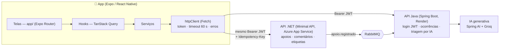

# Conserta Aí — App Mobile

> **Global Solution 2026/2 — CitizenTech · FIAP 2TDS**
> Disciplina: **Mobile Application Development** (React Native + Expo)

O **Conserta Aí** é um app de zeladoria urbana com participação cidadã. O morador reporta um problema da rua (buraco, poste apagado, lixo, árvore com risco de queda) e acompanha o atendimento. O gestor da prefeitura recebe uma fila já classificada e priorizada.

|                         |                                                                                                                                                                                                                                                                                                                                   |
| ----------------------- | --------------------------------------------------------------------------------------------------------------------------------------------------------------------------------------------------------------------------------------------------------------------------------------------------------------------------------- |
| **Cidadão beneficiado** | Morador que vê o problema na rua e quer resolvê-lo sem ligar no 156 e ficar sem retorno                                                                                                                                                                                                                                           |
| **Problema**            | Reports duplicados, mal descritos e sem prioridade. O cidadão não sabe se alguém já avisou e desiste                                                                                                                                                                                                                              |
| **Como o app resolve**  | <ul><li>A **IA generativa** (API Java) classifica cada ocorrência: categoria, urgência, órgão responsável, prazo e possível duplicada.</li><li>Em vez de duplicar, o cidadão **apoia** a ocorrência que já existe (API .NET), e a prioridade dela sobe na fila.</li><li>A linha do tempo mostra cada mudança de status.</li></ul> |
| **ODS**                 | **11** (cidades sustentáveis), **9** (infraestrutura) e **10** (redução das desigualdades)                                                                                                                                                                                                                                        |

📺 **Vídeo de demonstração:** https://youtu.be/gkn41yIynRU

---

## Sumário

1. [Arquitetura](#1-arquitetura)
2. [Requisitos da disciplina → implementação](#2-requisitos-da-disciplina--implementação)
3. [Telas e navegação](#3-telas-e-navegação)
4. [Estrutura de pastas](#4-estrutura-de-pastas)
5. [Como executar](#5-como-executar)
6. [Contas de teste](#6-contas-de-teste)
7. [Decisões técnicas](#7-decisões-técnicas)
8. [Publicação (Firebase App Distribution)](#8-publicação-firebase-app-distribution)
9. [Integrantes](#9-integrantes)

---

## 1. Arquitetura



- **Um login, duas APIs.** O app entra pela API Java, guarda o token no `expo-secure-store` e envia o mesmo `Authorization: Bearer` para a Java e para a .NET.
- **IA generativa.** Ao abrir uma ocorrência, a Java responde na hora com `EM_TRIAGEM`. O app consulta de novo a cada 3 segundos (até ~40 s) e mostra o resultado da IA assim que ele sai:
  - categoria, urgência e risco imediato;
  - resumo, órgão responsável e prazo;
  - aviso de possível duplicada.
- **Apoio em vez de duplicata.** Se a IA aponta uma ocorrência parecida, o app oferece apoiar a existente (`POST /apoios` na .NET) e remover a nova (`DELETE /ocorrencias/{id}` na Java). A .NET publica o evento no RabbitMQ e a Java recalcula a prioridade.

| Legenda            | Significado                                                 |
| ------------------ | ----------------------------------------------------------- |
| Seta cheia         | Requisição HTTP síncrona                                    |
| Losango (RabbitMQ) | Evento assíncrono entre as APIs (o app não fala com a fila) |

---

## 2. Requisitos da disciplina → implementação

| #   | Requisito (pts)                 | Como foi atendido                                                                                                                                                                                                                                                                                                                                                                                                                                                                                                                                                        | Onde ver                                                                                               |
| --- | ------------------------------- | ------------------------------------------------------------------------------------------------------------------------------------------------------------------------------------------------------------------------------------------------------------------------------------------------------------------------------------------------------------------------------------------------------------------------------------------------------------------------------------------------------------------------------------------------------------------------ | ------------------------------------------------------------------------------------------------------ |
| 1   | **6+ telas com navegação** (10) | <ul><li>12 telas, sem contar a "Sobre o App".</li><li>**Expo Router** com Stack e abas.</li><li>As abas mudam conforme o papel: o CIDADAO vê Cidade, Minhas e Conta; o GESTOR vê Fila, Cidade e Conta.</li><li>Formulários curtos abrem em modal.</li><li>"Voltar" respeita o histórico das abas.</li></ul>                                                                                                                                                                                                                                                              | `app/`                                                                                                 |
| 2   | **CRUD com a API (Fetch)** (30) | <ul><li>**Ocorrência** (API Java): Create, Read (lista, detalhe, histórico), Update e Delete.</li><li>**Comentário** (API .NET): Create, Read, Update e Delete.</li><li>**Apoio** (API .NET): Create e Delete.</li><li>**Status** (API Java): o gestor faz `PATCH`.</li><li>Nada é guardado só no aparelho.</li><li>Feedback visual:<ul><li>loaders;</li><li>aviso de servidor acordando após 5 s;</li><li>erros da API nos campos do formulário;</li><li>caixa de erro com "Tentar novamente";</li><li>puxar para atualizar.</li></ul></li></ul>                        | `src/api/`, `src/services/`, `src/hooks/`                                                              |
| 3   | **Autenticação** (20)           | <ul><li>Cadastro (`POST /auth/registro`) e login real (`POST /auth/login`) com JWT.</li><li>Validação dos formulários e indicador de carregamento.</li><li>**Logout** apaga o token do SecureStore e limpa o cache.</li><li>**Rotas protegidas** com `Stack.Protected`/`Tabs.Protected`: sem sessão, as telas internas não existem na navegação, nem por deep link.</li><li>Também há proteção **por papel**: abrir ocorrência só para CIDADAO, mudar status só para GESTOR.</li><li>Um **401** em qualquer chamada encerra a sessão e avisa na tela de login.</li></ul> | `src/contexts/AuthContext.tsx`, `src/api/sessaoStorage.ts`, `app/_layout.tsx`, `app/(app)/_layout.tsx` |
| 4   | **Estilização** (5)             | <ul><li>Identidade própria (laranja de cone de obra + azul-asfalto).</li><li>**Tema claro e escuro**: segue o aparelho ou a escolha manual.</li><li>**Fontes** Sora (títulos) e Inter (texto) em `assets/fonts`.</li><li>**Imagens** próprias em `assets/images` (ilustração da cidade, estado vazio, logotipo) e ícone adaptativo do Android.</li><li>Padrões do Material Design: FAB, chips, abas inferiores e área de toque de 48 dp.</li></ul>                                                                                                                       | `src/theme/`, `assets/`                                                                                |
| 5   | **Arquitetura** (20)            | <ul><li>Camadas separadas:<ul><li>**telas** (`app/`);</li><li>**componentes** (`src/components/`);</li><li>**hooks de dados** (`src/hooks/`);</li><li>**serviços** (`src/services/`);</li><li>**acesso HTTP** (`src/api/`);</li><li>**regras puras** (`src/domain/`);</li><li>**tema** (`src/theme/`).</li></ul></li><li>Nomes em português, padronizados.</li><li>ESLint (`eslint-config-expo`) e Prettier configurados.</li><li>Dependências mínimas (ver seção 7).</li></ul>                                                                                          | seção 4                                                                                                |
| 6   | **Vídeo** (10)                  | Até 5 minutos, com o app funcionando ponta a ponta                                                                                                                                                                                                                                                                                                                                                                                                                                                                                                                       | link no topo                                                                                           |
| 7   | **Publicação** (5)              | <ul><li>APK no Firebase App Distribution, com o professor como testador.</li><li>A tela **Sobre o App** mostra o hash do commit que gerou o build.</li></ul>                                                                                                                                                                                                                                                                                                                                                                                                             | seção 8, `app/(app)/sobre.tsx`                                                                         |

---

## 3. Telas e navegação

| Tela                                                            | Rota                             | Quem    | API                                                                                                                                                                      |
| --------------------------------------------------------------- | -------------------------------- | ------- | ------------------------------------------------------------------------------------------------------------------------------------------------------------------------ |
| Login                                                           | `/(auth)/login`                  | público | `POST /auth/login` (Java)                                                                                                                                                |
| Cadastro                                                        | `/(auth)/cadastro`               | público | `POST /auth/registro` (Java)                                                                                                                                             |
| Cidade (lista com filtros de status e bairro, rolagem infinita) | `/(app)/(abas)/`                 | todos   | `GET /ocorrencias` (Java)                                                                                                                                                |
| Minhas ocorrências                                              | `/(app)/(abas)/minhas`           | CIDADAO | `GET /ocorrencias/minhas` (Java)                                                                                                                                         |
| Fila de atendimento (por prioridade)                            | `/(app)/(abas)/fila`             | GESTOR  | `GET /ocorrencias/fila` (Java)                                                                                                                                           |
| Minha conta (tema, logout)                                      | `/(app)/(abas)/conta`            | todos   | —                                                                                                                                                                        |
| Nova ocorrência                                                 | `/(app)/ocorrencias/nova`        | CIDADAO | `GET /categorias`, `POST /ocorrencias` (Java)                                                                                                                            |
| Detalhe: triagem da IA, apoios, linha do tempo e comentários    | `/(app)/ocorrencias/[id]`        | todos   | <ul><li>`GET /ocorrencias/{id}` e `GET /ocorrencias/{id}/historico` (Java)</li><li>`GET /ocorrencias/{id}/apoios` e `GET /ocorrencias/{id}/comentarios` (.NET)</li></ul> |
| Editar ocorrência                                               | `/(app)/ocorrencias/[id]/editar` | autor   | `PUT /ocorrencias/{id}` (Java)                                                                                                                                           |
| Atualizar status                                                | `/(app)/ocorrencias/[id]/status` | GESTOR  | `PATCH /ocorrencias/{id}/status` (Java)                                                                                                                                  |
| Novo comentário                                                 | `/(app)/comentarios/novo`        | todos   | `GET /etiquetas`, `POST /comentarios` (.NET)                                                                                                                             |
| Editar comentário                                               | `/(app)/comentarios/[id]`        | autor   | `GET` e `PUT /comentarios/{id}` (.NET)                                                                                                                                   |
| Sobre o App (não conta para o requisito 1)                      | `/(app)/sobre`                   | todos   | —                                                                                                                                                                        |

Os botões **Editar** e **Excluir** de cada comentário não são decididos pelo app. Eles aparecem só quando a API .NET envia o link **HATEOAS** da ação: `update` para o autor, `delete` para o autor ou o gestor.

---

## 4. Estrutura de pastas

```
app/                          # Telas e navegação (Expo Router): cada arquivo é uma rota
├── _layout.tsx               # Fontes, tema, providers e proteção por sessão (Stack.Protected)
├── (auth)/                   # Login e cadastro (só sem sessão)
└── (app)/                    # Só com sessão
    ├── _layout.tsx           # Stack com cabeçalho + proteção por papel
    ├── (abas)/               # Cidade, Minhas | Fila, Conta
    ├── ocorrencias/          # nova, [id] (detalhe), [id]/editar, [id]/status
    ├── comentarios/          # novo, [id] (editar)
    └── sobre.tsx             # Versão publicada e hash do commit
src/
├── api/                      # Acesso HTTP: httpClient (Fetch), erros das duas APIs, sessão no SecureStore
├── services/                 # Um serviço por recurso: authService, ocorrenciasService, participacaoService
├── hooks/                    # TanStack Query: consultas, mutações, chaves de cache
├── contexts/                 # AuthContext (sessão compartilhada)
├── domain/                   # Regras puras: rótulos, cores, transições de status, permissões, validação
├── components/
│   ├── ui/                   # Botão, campo, estados (carregando/erro/vazio), chips, selo, tela
│   ├── ocorrencias/          # Cartão, selos, painel da IA, aviso de duplicada, linha do tempo, formulário
│   └── participacao/         # Painel de apoio, lista e formulário de comentários
├── config/                   # URLs das APIs e identificação da versão
├── lib/                      # QueryClient (política de novas tentativas)
├── theme/                    # Paletas clara/escura, tokens, fontes, criarEstilos
└── types/                    # Contratos das APIs em TypeScript
assets/
├── fonts/                    # Sora e Inter (licença OFL)
└── images/                   # Logotipo e ilustrações
```

As telas nunca chamam `fetch` diretamente. A cadeia é sempre:
`tela → hook (TanStack Query) → serviço → httpClient`.

---

## 5. Como executar

Pré-requisitos: Node 20+ e o app em um emulador Android ou aparelho.

```bash
npm ci
npx expo start
```

- **Expo Go:** funciona direto, porque o app não usa módulos nativos fora do Expo Go.
- **Web:** `npx expo start --web` para testar no navegador (as duas APIs liberam CORS).

### Endereços das APIs

Ficam em `src/config/env.ts`:

- **Java:** `https://gs-java-5k10.onrender.com`
- **.NET:** `https://consertaai-api-rm563454.azurewebsites.net`

Para apontar para outra instância (por exemplo, a .NET rodando no seu computador), copie `.env.example` para `.env`, ajuste e reinicie com `npx expo start -c`.

> A API Java fica no plano gratuito do Render, que **hiberna sem uso**: a primeira chamada do dia pode levar até 1 minuto. O app usa tempo limite de 60 s e avisa "o servidor pode estar acordando" em vez de mostrar erro. Antes de avaliar, abra https://gs-java-5k10.onrender.com no navegador.

### Qualidade de código

```bash
npm run lint          # ESLint (eslint-config-expo)
npm run typecheck     # TypeScript em modo strict
npm run format:check  # Prettier
```

---

## 6. Contas de teste

Senha de todas: **`senha123`**. A tela de login tem atalhos que preenchem cada conta.

| E-mail                  | Papel   | Para testar                             |
| ----------------------- | ------- | --------------------------------------- |
| `maria@consertaai.com`  | CIDADAO | Abrir ocorrência e ver a triagem da IA  |
| `joao@consertaai.com`   | CIDADAO | Apoiar e comentar a ocorrência da Maria |
| `gestor@consertaai.com` | GESTOR  | Fila priorizada e mudança de status     |

**Roteiro ponta a ponta:**

1. Maria abre "Árvore caindo na frente da creche" e vê a IA classificar e apontar a duplicada.
2. João apoia e comenta a ocorrência.
3. O gestor vê a ocorrência no topo da fila e muda o status para "Em andamento".
4. Maria vê a mudança na linha do tempo.

---

## 7. Decisões técnicas

| Decisão                                                | Por quê                                                                                                                                                                                                                                                                    | Alternativa considerada                                                             |
| ------------------------------------------------------ | -------------------------------------------------------------------------------------------------------------------------------------------------------------------------------------------------------------------------------------------------------------------------- | ----------------------------------------------------------------------------------- |
| **Fetch API** em um `httpClient` único                 | <ul><li>Nativo, sem dependência extra.</li><li>O cliente concentra:<ul><li>URL base;</li><li>token;</li><li>tempo limite de 60 s (`AbortController`);</li><li>tradução dos dois formatos de erro: o `ErroResponse` da Java e o ProblemDetails da .NET.</li></ul></li></ul> | Axios: interceptors prontos, mas mais uma biblioteca para o que 100 linhas resolvem |
| **TanStack Query**                                     | <ul><li>Cache, _loading_ e erro por tela.</li><li>Paginação infinita (`useInfiniteQuery`).</li><li>Novas tentativas só para falhas de rede e 5xx.</li><li>Consulta periódica da triagem (`refetchInterval`) enquanto o status é `EM_TRIAGEM`.</li></ul>                    | `useEffect` + `useState` em cada tela                                               |
| **expo-secure-store** para o token                     | O token fica criptografado (Keystore/Keychain), e não em texto puro                                                                                                                                                                                                        | AsyncStorage (usado só na web, onde o SecureStore não existe)                       |
| **expo-crypto** (`randomUUID`)                         | <ul><li>A .NET exige o cabeçalho `Idempotency-Key` nos POSTs de apoio e comentário.</li><li>Cada ação leva uma chave nova, então um reenvio por queda de rede não grava duas vezes.</li></ul>                                                                              | —                                                                                   |
| **Rotas protegidas pelo roteador** (`Stack.Protected`) | A tela protegida nem existe na árvore de navegação sem sessão, ou com o papel errado                                                                                                                                                                                       | Redirecionar com `useEffect`, que mostra a tela por um instante                     |
| **Fontes em `assets/fonts`** com `expo-font`           | Arquivos no projeto, carregados antes de esconder a splash                                                                                                                                                                                                                 | Pacotes `@expo-google-fonts/*`: trazem dezenas de pesos que não usamos              |

**Dependências além do template do Expo:**

- `@tanstack/react-query`
- `expo-secure-store`
- `expo-crypto`
- `expo-font`

---

## 8. Publicação (Firebase App Distribution)

1. O APK é gerado pelo **EAS Build** com o perfil `preview`:

   ```bash
   eas build -p android --profile preview
   ```

   O `eas.json` tem `requireCommit: true`, então não há build com alterações não commitadas.

2. O `app.config.js` grava o hash do commit (`EAS_BUILD_GIT_COMMIT_HASH`) no app. A tela **Conta → Sobre o App** mostra esse hash, a versão e o número do build.
3. O APK é enviado ao **Firebase App Distribution** (app Android `br.com.fiap.consertaai`), com o e-mail do professor como testador.

| Item                 | Valor            |
| -------------------- | ---------------- |
| Versão publicada     | VERSAO_PUBLICADA |
| Commit de referência | HASH_DO_COMMIT   |

---

## 9. Integrantes

| Nome                         | RM       | Turma  |
| ---------------------------- | -------- | ------ |
| Pedro Gabriel Claes Ferreira | RM566058 | 2TDSPV |
| Matheus Arazin de Oliveira   | RM556649 | 2TDSPV |
| Artur Pioli Silva            | RM565597 | 2TDSPV |
| Kevin Martins Campos         | RM563454 | 2TDSPV |
